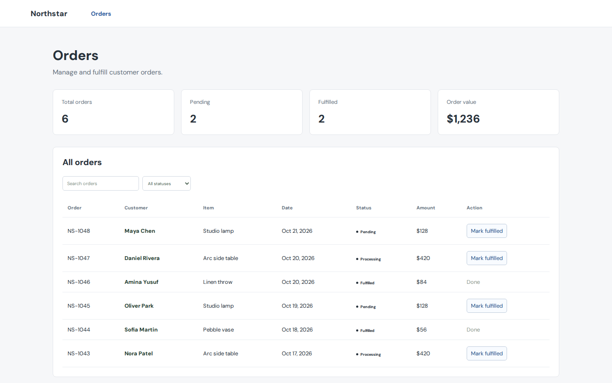
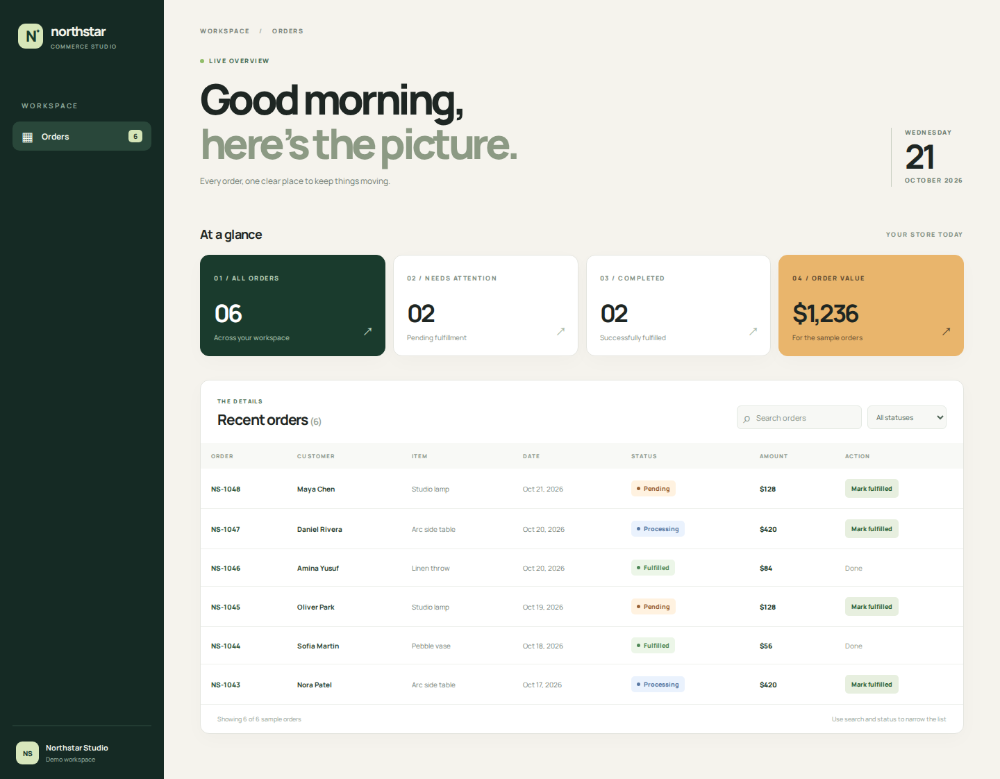

# Design to Production

**Migrate a React or Next.js page to an HTML design without losing the app behind it.**

`design-to-production` is a reusable Agent Skill for Codex and Claude Code. It treats the supplied HTML as the visual reference and the existing application as the source of truth for data, actions, routes, and permissions. It inventories both, shows a component-to-functionality mapping, and **waits for your approval before editing the target page**.

| Existing React page | Same page after applying the HTML design |
| --- | --- |
|  |  |

This is a [runnable, invented example](examples/order-dashboard/README.md), not a customer project or proof that any arbitrary HTML file will migrate perfectly. See the [HTML reference](examples/order-dashboard/reference.html), [mapping and approval record](examples/order-dashboard/MIGRATION.md), and [mobile screenshot](examples/order-dashboard/evidence/after-mobile.png).

## What you get

1. **Before implementation:** an inventory of the current page, an inventory of the HTML design, a mapping between visual elements and real functionality, design/behavior conflicts, and an implementation and verification plan.
2. **An approval checkpoint:** the agent stops before creating a migration branch or changing application code. You approve the specific target and plan. Backend, permission, business-rule, or feature-removal changes need explicit approval as well.
3. **After approval:** native React or Next.js presentation code connected to existing data and actions, followed by relevant tests and desktop/mobile comparison with reported gaps.

The skill does not fabricate production numbers, silently remove controls, or claim pixel-perfect fidelity without evidence. It records missing external assets and anything it could not verify.

## Install from GitHub

Review the repository contents before installing a third-party skill. For a personal installation that works across local projects, clone once and link the folder into each tool's skill directory:

```bash
git clone https://github.com/yonash24/design-to-production.git ~/design-to-production
python3 ~/design-to-production/scripts/check_skill.py
mkdir -p ~/.agents/skills ~/.claude/skills
ln -s ~/design-to-production ~/.agents/skills/design-to-production
ln -s ~/design-to-production ~/.claude/skills/design-to-production
```

If either destination already exists, inspect it first and choose one installed copy to avoid duplicate versions. Codex's current personal skill location is [`~/.agents/skills`](https://learn.chatgpt.com/docs/build-skills); Claude Code's is [`~/.claude/skills`](https://code.claude.com/docs/en/skills). Both tools can follow symlinked skill folders. A new session may be needed if a newly installed skill does not appear.

For a **project-only** installation, copy `SKILL.md`, `references/`, `scripts/`, and `agents/` to `<your-app>/.agents/skills/design-to-production/` for Codex and `<your-app>/.claude/skills/design-to-production/` for Claude Code. Commit those directories if the team should share them. Local personal installations are not automatically available in cloud sessions.

## Use

Open the target application's repository and attach the HTML file **with its local CSS, JavaScript, fonts, images, and other assets**, or give their paths. Then invoke:

```text
Codex:       Use $design-to-production to migrate the orders page using the attached HTML. Analyze and present the mapping first.
Claude Code: /design-to-production Migrate the orders page using the attached HTML. Analyze and present the mapping first.
```

The skill defaults to `analyze`. Review the mapping and approve the proposed target and plan before it moves to `implement`. Use `verify` to inspect an existing migration. If the target page or reference is missing or ambiguous, the agent should ask rather than invent it.

## Example and evidence

The [Northstar example](examples/order-dashboard/README.md) has a static HTML visual reference and a small React app with before and after views. Both React views use the same local sample orders, search, status filter, fulfillment action, and derived counts. The [migration record](examples/order-dashboard/MIGRATION.md) shows how those behaviors map to the reference. A Playwright script regenerates six screenshots and exercises the interactions at desktop and mobile widths.

## Scope and limitations

- Designed for an **existing React or Next.js page** and an HTML/CSS/JS reference. It does not install a new application or implement backend features implied only by the design.
- Fidelity depends on accessible assets, observable interaction states, representative test data, and a runnable app. Unavailable pieces are reported as gaps.
- The skill currently does **not** define a deterministic choice among several alternative designs in one upload. Identify the desired design in the request when supplying alternatives.
- Skill instructions guide an agent; they do not replace review, permissions, or runtime verification.

## Contribute

Run `python3 scripts/check_skill.py` before a change to the skill package. Issues describing a missed state, unclear mapping, or installation problem are especially useful. If the workflow helps your migration, [star the repository](https://github.com/yonash24/design-to-production).

MIT licensed. See [LICENSE](LICENSE).
