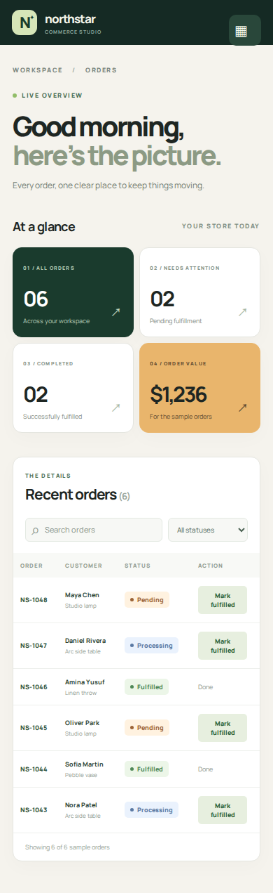

# Northstar orders: a runnable migration example

This small React app shows one orders page in two presentations using the **same local state, sample data, search, status filter, and fulfillment action**. The [HTML reference](reference.html) is a separate static design target; the [migration record](MIGRATION.md) shows the mapping and the approval checkpoint that a real skill run should present.

All people, orders, and amounts are invented examples. No production data or service is connected.

| Before: existing React UI | After: HTML design applied to React |
| --- | --- |
|  |  |

## Run it

```bash
cd examples/order-dashboard
npm ci
npm run dev -- --port 4173
```

Open `http://127.0.0.1:4173/?view=before` and `http://127.0.0.1:4173/?view=after`. The HTML design is at `http://127.0.0.1:4173/reference.html`.

In a second terminal, run `npm run capture` to regenerate desktop and mobile screenshots and exercise the shared interactions. Run `npm run build` to verify the production bundle. Playwright needs a Chromium browser installed; if it is missing, run `npx playwright install chromium` first. The stylesheet requests Google Fonts when online and falls back to system fonts when offline.


